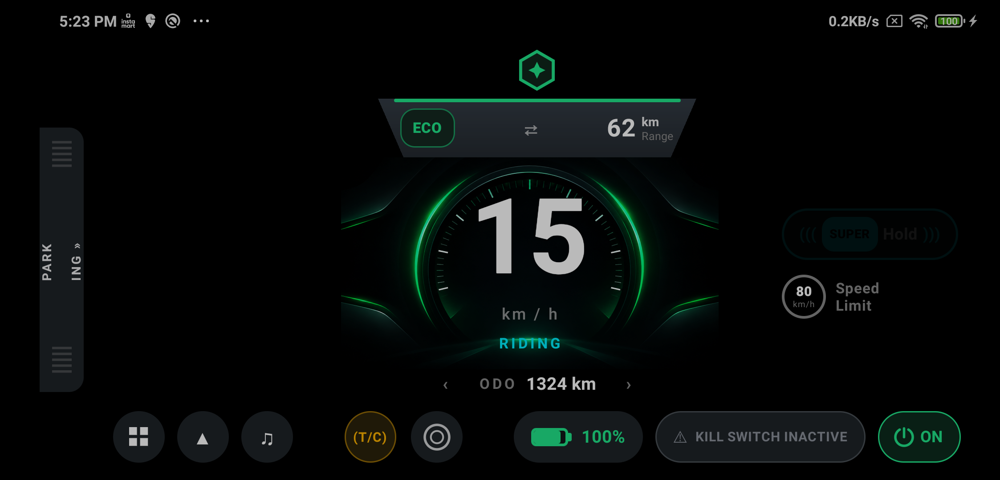
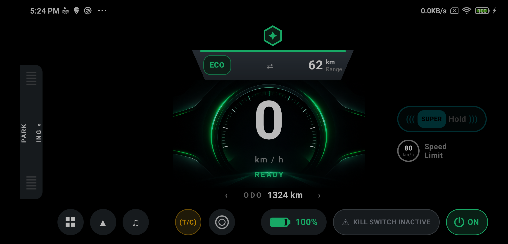
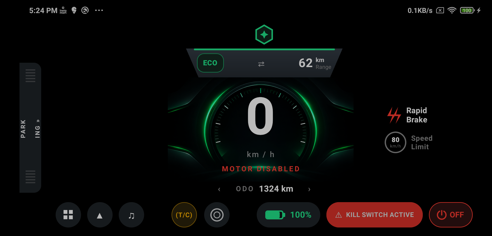

# SimpleRide – Android HMI Home/Ride Dashboard

A landscape Jetpack Compose dashboard for an electric two-wheeler. It shows speed (km/h), motor status (ON/OFF) and kill-switch status (Active/Inactive), driven by a simulated vehicle-data stream. The UI updates on its own as the data changes.

## Build & run

**Requirements:** Android Studio (recent stable), JDK 17+, Android SDK with API 36/37, an emulator or device (min API 27).

1. Open the project folder in Android Studio and let Gradle sync.
2. Press **Run**. The activity is locked to landscape (`sensorLandscape`).

```

## Running the tests

```bash
./gradlew :app:testDebugUnitTest
```

HTML report: `app/build/reports/tests/testDebugUnitTest/index.html`. In Android Studio you can also right-click `app/src/test` → *Run 'Tests in test'*.

| Test class | What it covers |
|---|---|
| `VehicleViewModelTest` | Full five-scenario sequence at 1 s intervals (virtual time), negative speed, recovery after an invalid sample, stale-signal timeout, data-source failure + automatic retry |
| `VehicleStateReducerTest` | Stale/future timestamps, implausible and infinite speed, missing signals, invalid battery, ride-state derivation (coasting with motor OFF, kill switch priority), rapid-brake detection |

## Simulated scenarios

`SimulatedVehicleDataSource` emits one sample per second and loops:

| # | Scenario | Speed | Motor | Kill switch | Shown ride state |
|---|---|---|---|---|---|
| 1 | Parked | 0 km/h | OFF | Inactive | PARKED |
| 2 | Ready | 0 km/h | ON | Inactive | READY (+ SuperHold badge) |
| 3 | Riding | 25 km/h | ON | Inactive | RIDING |
| 4 | Accelerating | 50 km/h | ON | Inactive | RIDING |
| 5 | Motor disabled | 0 km/h | OFF | **Active** | MOTOR DISABLED (red pulsing kill-switch pill, Rapid Brake alert for the 50 → 0 drop) |

## Architecture

```
data/
  model/VehicleData            raw sample; every signal nullable
  source/VehicleDataSource     interface (simulator today, CAN/VHAL later)
  source/SimulatedVehicleDataSource   Flow + delay(1000), scripted scenarios
  repository/VehicleRepository single entry point for the UI layer
presentation/
  model/VehicleUiState         immutable UI state (+ RideState, SignalStatus)
  model/VehicleStateReducer    pure validation/mapping rules (unit-tested)
  viewmodel/VehicleViewModel   collects the flow, exposes StateFlow<VehicleUiState>
  screen/HomeScreen            stateless composable, renders VehicleUiState
  components/…                 Speedometer, MotorStatusPill, KillSwitchPill, etc.
```

Data flow (one direction only):

```
SimulatedVehicleDataSource ──Flow<VehicleData> -> VehicleData> -> VehicleRepository -> VehicleViewModel
        ──StateFlow<VehicleUiState> ->  collectAsStateWithLifecycle() -> HomeScreen
```

- **Coroutines / Flow:** the simulator is a cold `flow {}` with `delay(1000)`. The ViewModel collects it in `viewModelScope`, so collection stops when the ViewModel is cleared.
- **StateFlow:** the ViewModel holds one `MutableStateFlow` and exposes it read-only. Updates go through `update {}` and the pure `VehicleStateReducer`.
- **Lifecycle-aware UI:** `collectAsStateWithLifecycle()` stops collecting while the app is in the background.

## Edge cases handled

| Case | Behaviour |
|---|---|
| Negative, NaN, infinite or > 250 km/h speed | Speed shows `--`; the other signals still update; amber "Invalid speed signal" banner |
| Missing signal (`null`) | That value shows `--`; ride state becomes unknown; amber banner names the missing signal |
| Battery outside 0–100 % | Shown as `--%` |
| No sample for 3 s (stale stream) | Watchdog (`transformLatest` + `delay`) clears every live value to `--`; red "Vehicle signal lost" banner. Clears itself on the next sample |
| Sample timestamp older than 3 s, or from the future | Treated as stale |
| Data source throws | Red "Unable to read vehicle data. Retrying…" banner; `retryWhen` resubscribes after 2 s; no crash |
| Before the first sample | "Waiting for vehicle data…" with `--` values, not fake numbers |

Values that can't be trusted are blanked rather than frozen. A stale speed reading on a vehicle display is worse than no reading.

## Screenshots

<p align="center">
  
  
  
</p>